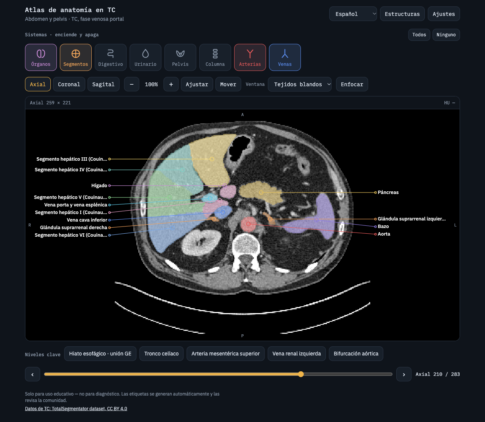

# CT Anatomy Atlas

An open, multilingual web atlas of cross-sectional anatomy on real CT scans. Scroll through a
scan in axial, coronal or sagittal view. Switch coloured structures on and off by system (organs,
Couinaud liver segments, digestive, urinary, pelvis, spine, arteries, veins), read the labels, and
jump to key levels such as the celiac trunk or the renal veins.

It's for medical students, doctors, and anyone learning anatomy. **Educational use only — not
for diagnosis.** The labels are generated automatically and reviewed by the community. If
you spot a mistake, use "Report a problem" on the structure.



Languages: English, Deutsch, Español, العربية, Français, Italiano, Nederlands.

## Run it locally

```sh
python3 -m http.server -d site 8000   # then open http://localhost:8000
```

There's no build step and there are no dependencies. `site/` is the whole website.

## Deploy

Upload `site/` to any static host (GitHub Pages, Cloudflare Pages, Netlify, …). Each case is
about 21 MB and loads in the browser.

## Tests

```sh
npm test                      # viewer modules (Node built-in test runner, no npm install needed)
uv venv -p 3.12 .venv && uv pip install -p .venv -r pipeline/requirements.txt
.venv/bin/pytest pipeline -q  # case pipeline
```

## Adding a case, fixing a label, adding a language

See [CONTRIBUTING.md](CONTRIBUTING.md).

## Credits and licences

- CT data and segmentations come from the **TotalSegmentator dataset**
  ([doi:10.5281/zenodo.6802613](https://doi.org/10.5281/zenodo.6802613)), licensed
  [CC BY 4.0](https://creativecommons.org/licenses/by/4.0/). Case `s0010` uses that dataset's
  masks, plus Couinaud liver segments generated with the open `liver_segments` model from
  [TotalSegmentator](https://github.com/wasserth/TotalSegmentator) (Apache-2.0).
- Code: [MIT](LICENSE).
